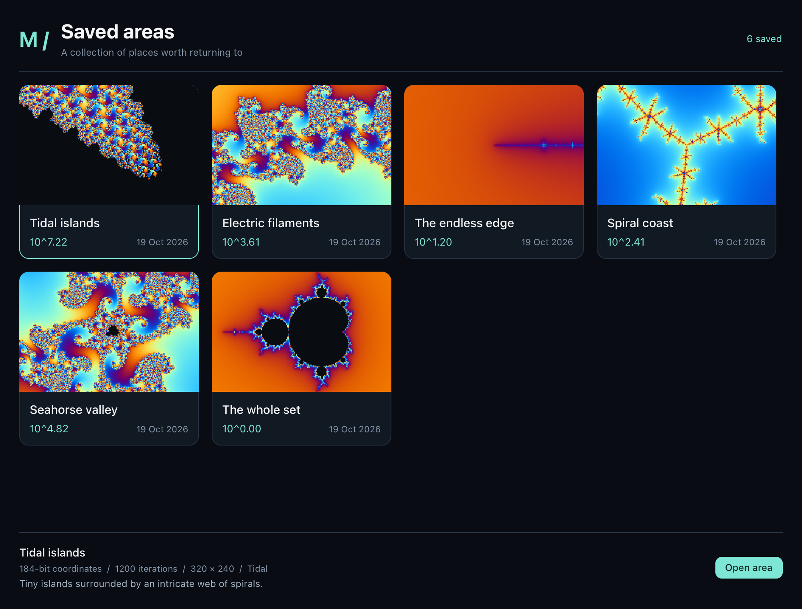

# Mandel

A native Mandelbrot explorer built with Zig 0.17.0 and NanoUI. macOS / Apple Silicon is the initial supported target.



## Download and verify

Download `Mandel-macos-arm64.zip` from [GitHub Releases](https://github.com/valland/Mandel/releases). Release builds target Apple Silicon on macOS 15 or later. Verify a downloaded release with:

```sh
gh attestation verify Mandel-macos-arm64.zip --repo valland/Mandel
```

Tagged releases are built by GitHub Actions and carry Sigstore build-provenance attestations for both the app ZIP and corresponding source archive. These attestations bind the artifact hashes to the workflow and source commit; they are not Apple code signing or a guarantee of reproducible builds. The app is ad-hoc signed, not notarized; Gatekeeper may require approval through System Settings → Privacy & Security → Open Anyway.

CI runs `test-cpu` and compiles the full test suite with `test-build`. Run `test` on a physical Mac to exercise Metal and native UI as well. To publish a new version, update the versions in `build.zig.zon` and `tools/package.sh`, commit, and push a matching `vX.Y.Z` tag. Branch builds produce workflow artifacts; only tag pushes publish and attest releases.

Mandel is MIT licensed. Releases include corresponding library sources and license notices; see [DISTRIBUTION.md](DISTRIBUTION.md) for rebuilding with modified GMP/MPFR libraries.

## Build and run

Requires an Apple Silicon Mac and Xcode Command Line Tools (`xcode-select --install`).

```sh
git clone https://github.com/valland/Mandel.git
cd Mandel
./tools/bootstrap.sh
./run.command
```

Bootstrap downloads a pinned Zig compiler and builds GMP 6.3.0 and MPFR 4.2.2 locally. Nothing is installed globally. NanoUI, including the local rendering changes, is included in this repository; no submodule setup is needed.

To create a double-clickable app:

```sh
./tools/package.sh
open zig-out/Mandel.app
```

Build outputs and the downloaded toolchain are generated locally and are not included in the repository.

## Explore

- Scroll over the image to zoom toward the pointer; drag to pan.
- Space starts/pauses automatic zoom. `+` / `-` zoom about the center; `R` resets.
- Choose a destination, select **Zoom in** or **Zoom out**, then **Start journey**. You can switch direction while travelling. Outward travel stops at the overview limit (zoom 2^-2). Speed slows automatically when rendering falls behind. The default is now 2 octaves/second, with an upper setting of 8; these are requested speeds, not guaranteed throughput.
- **The endless edge** targets the exact Mandelbrot boundary point `-2 + 0i`. The other destinations have finite decimal coordinates and eventually leave their interesting region.
- Palettes can be changed while rendering. Resolution always follows the canvas size in physical pixels, including Retina scale.
- Increase the iteration budget if details remain dark. Dark pixels are *unresolved within that budget*, not a mathematical proof of membership.
- **Save area...** pauses travel and renders an exact preview. Enter a name and optional comment, then choose **Save to disk**.
- **Saved areas** opens a responsive thumbnail gallery, newest first. Click a thumbnail to select it and show its comment and metadata; double-click to restore the area. **Open area** also restores the selected location and rendering settings. The save form appears only while naming a new area. New previews are up to 384 pixels on their longest side; existing previews remain compatible.

## Saved areas

The library persists across restarts at `~/Library/Application Support/Mandel/places.json`. It is a versioned JSON document containing full-precision hexadecimal MPFR coordinates, log2 zoom, metadata, comments and embedded PNG thumbnails. Copy this file to back up the library. Writes use atomic replacement; an unreadable library disables saving rather than replacing existing data. Thumbnails reflect the viewport aspect ratio at capture time; reopening renders for the current window size.

`MANDEL_LIBRARY_PATH` overrides the location. Headless snapshots do not access the real library unless this override is supplied. Tests use temporary directories only. Comments are single-line, up to the text field's 1024-byte capacity.

## Numerical approach and limits

The iteration budget grows automatically with extreme zoom depth (the slider sets its minimum). Camera coordinates use MPFR; precision increases with zoom depth plus 160 guard bits. The camera stores log2 zoom, so scale is constructed in MPFR without passing through a floating-point underflow. There is no preset application zoom cutoff; memory, MPFR exponent range and computation time are finite.

Metal uses double-single arithmetic and MPFR reference orbits. Ordinary-depth perturbation avoids per-iteration exponent bookkeeping. Between 2^40 and 2^100, a hierarchy of bivariate linear approximations (BLA) skips multiple iterations when both its validity radius and quadratic remainder check permit it. More extreme zooms use rescaled perturbation and a shared linear prefix. BLA follows [mathr's description](https://mathr.co.uk/web/deep-zoom.html), with additional remainder estimates; invalid or overflowing nodes are disabled.

GPU work keeps two bounded batches in flight instead of waiting after every dispatch. Error estimates propagate through ordinary steps, BLA skips and rebasing. Escaped pixels are accepted only when the estimated smooth-color interval is narrower than 0.001 iterations (the palette lookup interval is about 0.0094). Uncertain bailout decisions and cancellation glitches request CPU refinement. The CPU uses FP64 perturbation, then double-double arithmetic with MPFR reference low parts, then direct MPFR for the remaining difficult pixels. These estimates are numerically tested, not a directed-rounding interval proof.

Automatic zoom uses **exact temporal sample reuse** on centered, odd-sized grids one octave apart. About one quarter of the next frame's sample coordinates coincide exactly with samples from the previous frame. Their colors and escape results are copied; the other samples are evaluated live. Inward GPU work packs the three missing samples of each 2×2 cell together rather than leaving inactive lanes. CPU refinement uses centered coordinate arithmetic so dyadic zoom steps preserve the same sample positions.

Reuse requires the same center, dimensions, palette and iteration budget, and an exact one-octave step. Pan, resize, palette/detail changes and incompatible steps use fresh computation. Manual exploration, pause and saved-area previews still request complete native renders. This is a conservative first temporal implementation, not an adaptive color-based approximation or a prerecorded zoom.

Frames are rendered at **2.6 times the physical viewport dimensions**, rounded up to odd dimensions: a 1764 × 1388 Retina canvas uses 4587 × 3609 samples. This larger image covers a full octave between replacements, versus 0.35 octaves in the old renderer. Fewer replacement images are needed per zoom doubling. The UI reprojects them continuously while new samples are computed, reserving at least 1.15 source samples per physical pixel. Completed upcoming frames extend the motion budget before promotion, avoiding needless braking. Outward motion also checks spatial coverage to prevent unrendered edges.

The larger grids and the extra retained sample/color cache increase memory use and initial rendering latency. Only the previous computation is retained for reuse; there is no disk zoom cache or growing history. Changes to settings can remove the reuse benefit until another compatible frame is completed.

The speed slider is an upper bound. Complex regions reduce travel speed to sustain detail. Pause requests a fresh native-resolution render. Manual pan/zoom requests likewise calculate the new view; while waiting, the previous image is never enlarged beyond its physical pixel density. Resizing may temporarily leave uncovered margins until the resized render arrives. There is no guarantee of a fixed display rate or fixed travel speed at arbitrary depth.

An almost entirely unresolved upcoming frame is retried with a larger iteration budget before displaying it. Automatic retries stop at 32,000 iterations; the depth-dependent minimum can grow beyond that. This cannot turn a true interior point into a boundary point. Use **The endless edge** for an exact, indefinitely refinable target; the other destinations retain finite coordinates.

A dedicated raw-image surface replaces the thumbnail atlas for Mandelbrot pixels. Its size follows the render, without the old 1000-pixel cap. Uploads run on the UI Metal queue, ordered after prior draws. Only one decoded image is retained in the UI; completed current and upcoming frames remain owned by the application. Image storage is reused across equal-size uploads. Paused, settled views do not request continuous frames.

## Performance

Measurements below are local, after shader warm-up, using five measured runs. Compute timings are distinct from animation presentation timings.

| Compute workload | Resolution | Median |
|---|---:|---:|
| Seahorse, 2^16 | 1764 × 1388 | 155 ms |
| Seahorse, 2^24 | 1764 × 1388 | 254 ms |
| Seahorse, 2^64, BLA disabled | 800 × 600 | 39.7 ms |
| Seahorse, 2^64, BLA enabled | 800 × 600 | 28.1 ms |
| Overview | 800 × 600 | 3.6 ms |
| Exact edge, 2^4000 | 800 × 600 | 1.7 ms |

BLA skipped 722 iterations for the first pixel in the 2^64 comparison, reducing measured time by about 29%. It is deliberately bypassed where valid skips are unlikely. The previous native 2^24 baseline was about 420 ms. The 2^16 workload is slower than the old ~100 ms result because expanded MPFR checks exposed inaccurate CPU fallback results; the corrected precision escalation is retained. Compute acceleration varies strongly with location.

Version 0.6.0 was compared against the old 1.7× / 0.35-octave renderer, using 360-frame offscreen Retina runs per case. Both requested 2 octaves/second. These are actual camera travel rates, not display FPS:

| Starting view / direction | Previous | Temporal | Speedup |
|---|---:|---:|---:|
| Seahorse 2^16, inward | 0.561 oct/s | 0.826 oct/s | 1.47× |
| Seahorse 2^24, inward | 0.375 oct/s | 0.547 oct/s | 1.46× |
| Seahorse 2^16, outward | 0.758 oct/s | 1.317 oct/s | 1.74× |
| Seahorse 2^24, outward | 0.374 oct/s | 0.546 oct/s | 1.46× |

All 1440 temporal display frames advanced, with no uncovered edges and at least 1.151 samples per physical pixel. Compatible frames reused 4,138,865 samples each. Presentation medians were 8.28–9.00 ms; p95 was 14.87–16.05 ms. This gain combines larger spacing between full image replacements, exact sample reuse and motion scheduling; it is not a claim that reuse alone accounts for the whole improvement.

These short local runs include GPU readback and move through changing fractal detail. They are not a guarantee of fixed zoom speed at other locations. Reprojected frames are distinct from fresh fractal calculations; the final large keyframes in these runs took 255–1323 ms. The controller continues to slow before native sample density is exhausted.

```sh
./tools/zig build bench -Doptimize=ReleaseFast
./tools/zig build bench-animation -Doptimize=ReleaseFast
```

## Layout

- `src/main.zig`: application, controls, navigation and job lifecycle.
- `src/places.zig`, `src/library_ui.zig`: atomic disk library, exact coordinates, thumbnails and library window.
- `src/precision.zig`: MPFR ownership and camera transformations.
- `src/fractal.zig`: escape-time, perturbation and direct MPFR kernels.
- `src/compute.zig`, `src/compute.metal`: cached Metal pipeline, rescaled double-single kernels and error tracking.
- `src/bla.zig`: BLA hierarchy, validity radii and quadratic remainder estimates.
- `src/scaled.zig`, `src/wide.zig`, `src/prefix.zig`: FP64/double-double refinement, rescaled perturbation and shared prefix skipping.
- `src/reference.zig`, `src/engine.zig`: reusable orbit and GPU resources.
- `src/worker.zig`: cancellable coordination and parallel CPU refinement.
- `src/reuse.zig`: exact dyadic sample mapping and bounded previous-frame cache.
- `src/frames.zig`, `src/motion.zig`: oversampled prefetch, geometry-preserving promotion and pixel-density-limited motion.
- `src/display.zig`: native-resolution raw-image adapter to NanoUI.

NanoUI is vendored at `0035195c45934691e2f53e7e8c6d83a51002ef3b`. A small local extension in `images.zig` and `metal.zig` supports a dynamically sized raw-image surface; the application adapter is `display.zig`. Upgrading NanoUI requires checking this adapter. Linux/Windows are not implemented in this app yet.

## Verify

```sh
./tools/zig build test -Doptimize=ReleaseSafe
```

Tests cover known Mandelbrot points, GPU and CPU results against MPFR through 2^4000 magnification, prefix skipping, cache invalidation, BLA skipping, prefetch promotion, delayed-frame density limits, Retina single-pixel fidelity beyond 2048 pixels, native controls and queued texture replacement. Cancellation and minimum-window layout are also checked. Navigation tests exercise plain Space, R and +/− through the native text-input path, plus shortcut delivery and button focus. Library tests verify exact round trips at 2^4000, comments and thumbnail persistence, write-failure rollback, corrupt-file preservation, capture and restoration. A pixel-level regression checks that saved thumbnails remain visible when the native window installs its image sink after the first paint; the library keeps a CPU-backed thumbnail atlas to avoid mixing upload paths. UI tests use offscreen rendering and write `/tmp/mandel-preview.png` and `/tmp/mandel-library.png`. Gallery tests check that a single click selects, a double-click opens the correct record exactly once, and controls remain accessible at minimum window size. The animation benchmark checks both zoom directions at Retina resolution, including edge coverage. Temporal tests compare every sample against fresh rendering in both directions, for both grid parities and fractional zoom levels, and check invalidation after pan, resize, palette and budget changes.

The local NanoUI extension also passes its line-count check and Linux/Windows cross-builds. Linux runtime tests require Docker, which was unavailable in this environment.

To rebuild the macOS app bundle: `./tools/package.sh`.

## Third-party code

NanoUI: MIT (see `vendor/nanoui/LICENSE` and its third-party notices).
GMP: dual LGPLv3/GPLv2; MPFR: LGPLv3 or later. The local build statically links these libraries. Their source URLs and exact versions are pinned in `tools/bootstrap.sh`; preserve the relevant license and relinking/source obligations if distributing binaries.
